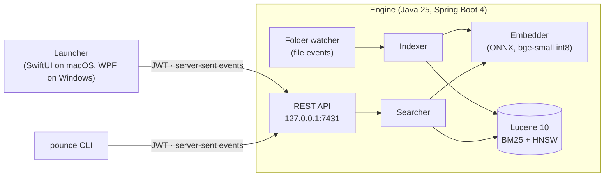

# Pounce

[](https://github.com/RashidIsmayilzada/Pounce/actions/workflows/ci.yml)
[](https://github.com/RashidIsmayilzada/Pounce/releases/latest)
[](https://github.com/RashidIsmayilzada/homebrew-tap)
[](#macos)
[](#windows)
[](LICENSE)
[](https://github.com/RashidIsmayilzada/Pounce/issues?q=is%3Aissue+is%3Aopen+label%3A%22good+first+issue%22)

**Private, on-device semantic search for macOS and Windows.** Press a shortcut, start typing, and find your files by what they *say*, not only by their name. Everything runs on your computer: no cloud, no API calls.


<sub>Real search results over a sample folder of fictional documents. [MP4 version](docs/media/pounce-demo.mp4).</sub>

Spotlight finds `certificate-renewal.md` when you type "certificate". Pounce also finds it when you type *"how do I renew the ssl cert"*, because it compares meaning, while still matching exact words like error codes and file names.

## Features

- **Search as you type** with a panel on ⌥Space (macOS) or Alt+Space (Windows): keyword results appear instantly, then are refined by meaning a few milliseconds later.
- **Apps and files in one list**: matching applications come first, then files.
- **Hybrid ranking**: BM25 keyword search and vector search from one Lucene index, merged with Reciprocal Rank Fusion.
- **On-device embeddings**: `bge-small-en-v1.5` (int8) through ONNX Runtime, sized for a laptop with 8 GB of RAM.
- **Live indexing** from the system's own file events; on a Mac, a saved, renamed or deleted file shows up in search in about half a second.
- **Text, Markdown, code and PDFs**, with the matching passage shown and the query's words highlighted.
- **Cloud files stay in the cloud**: files that OneDrive keeps online only are not downloaded to be indexed.
- **Private by design**: the engine listens on `127.0.0.1` only and every request needs a short-lived, self-issued JWT.
- **`pounce` command** for the terminal, alongside the launchers.

## Install

### macOS

With [Homebrew](https://brew.sh):

```bash
brew install --cask rashidismayilzada/tap/pounce
```

To use the short name, add the tap once: `brew tap rashidismayilzada/tap && brew trust rashidismayilzada/tap`; after that `brew install pounce` and `brew upgrade pounce` work.

Or download `Pounce-<version>-macos-arm64.zip` from [Releases](https://github.com/RashidIsmayilzada/Pounce/releases), unzip it and move `Pounce.app` to `/Applications`.

Pounce is not notarized yet, so the first time macOS will say it can't verify the developer: right-click `Pounce.app` → **Open** → **Open** (or *System Settings → Privacy & Security → Open Anyway*). macOS then asks for access to the folders Pounce watches. Press **⌥Space** to search.

Pounce watches `~/Documents`, `~/Desktop`, `~/Downloads` and `~/projects` by default, skipping any that don't exist. To change that, edit `~/Library/Application Support/Pounce/pounce.yml` and restart Pounce from its menu-bar icon:

```yaml
pounce:
  watched-folders: /Users/you/Documents,/Users/you/notes
```

Requires macOS 14 or later on Apple Silicon.

### Windows

Windows support is new. Please [report](https://github.com/RashidIsmayilzada/Pounce/issues/new/choose) anything that doesn't work.

1. Download `Pounce-<version>-windows-x64.zip` from [Releases](https://github.com/RashidIsmayilzada/Pounce/releases) and unzip it to a folder on your own disk, for example your user folder. It holds a `Pounce` folder.
2. Run `Pounce.exe` in that folder. Pounce is not code-signed yet, so the first time Windows SmartScreen says "Windows protected your PC": click **More info** → **Run anyway**.
3. Pounce puts its icon in the notification area of the taskbar and starts indexing. Press **Alt+Space** to search.

In the panel, ↑↓ select, Enter opens, Ctrl+Enter shows the file in File Explorer, and Esc closes. If another program already holds Alt+Space, Pounce uses Ctrl+Alt+Space, or else Alt+Shift+Space; the tray icon's menu says which. To pick one yourself, set the environment variable `POUNCE_HOTKEY`, for example to `control-alt-space`.

Pounce's search engine needs the [Microsoft Visual C++ Redistributable (x64)](https://learn.microsoft.com/cpp/windows/latest-supported-vc-redist), which most PCs already have. Without it, the tray icon's menu says "Pounce needs the Microsoft Visual C++ Redistributable (x64)"; install it, then start Pounce again.

On its first run Pounce writes `%LOCALAPPDATA%\Pounce\pounce.yml`, listing your Documents, Desktop and Downloads folders wherever Windows keeps them (OneDrive included). To change the Watched Folders, choose **Settings file…** in the tray icon's menu, edit the list, then choose **Quit Pounce** and start `Pounce.exe` again:

```yaml
pounce:
  watched-folders:
    - 'C:\Users\you\Documents'
    - 'D:\notes'
```

Write each path in single quotes, or with forward slashes (`D:/notes`). In double quotes a backslash starts an escape sequence, and the YAML error stops the search engine.

**Launch at login** in the same menu starts Pounce when you sign in. To quit, choose **Quit Pounce**, or run `Pounce.exe --quit`; the search engine stops with it. To uninstall, turn off **Launch at login**, quit Pounce, and delete the `Pounce` folder and `%LOCALAPPDATA%\Pounce` (the index, the settings and the logs). When something goes wrong, `launcher.log` and `engine.log` in `%LOCALAPPDATA%\Pounce\logs` usually say why.

Requires Windows 11 on x64. Windows 10 is not supported.

## How it works



The Engine is an onion of Maven modules: `pounce-domain` → `pounce-application` → `pounce-infrastructure` → `pounce-api`. Dependencies point inward only, which the compiler and ArchUnit tests enforce. Beside it, `pounce-platform` knows where Pounce keeps its data and which folders it watches on each operating system. The Engine and its tests also run on Linux, but there is no Linux app.

The Launcher is the app you run: `Pounce.app` on macOS, `Pounce.exe` on Windows. It starts and supervises the Engine as a child process, with a trimmed Java runtime and the model bundled with it, and the Engine exits when the Launcher does.

Design decisions are recorded in [`docs/adr/`](docs/adr/), the module design in [`docs/design/`](docs/design/), and measurements in [`docs/research/`](docs/research/).

## Performance

Measured on an M2 MacBook Air with 8 GB of RAM ([details](docs/research/2026-11-23-speed-spike-verdict.md)):

| | p50 | p95 |
|---|---|---|
| Keyword results (50,000 documents) | 1.0 ms | 8.3 ms |
| Full hybrid results (50,000 documents) | 5.0 ms | 12.9 ms |
| Query embedding | 2.1 ms | 3.2 ms |

On the same Mac, the running app uses roughly 230–450 MB, most of it while indexing, and a new or changed file is searchable after about 0.5 s. Windows has not been measured yet.

## Build from source

### macOS

Needs JDK 25, Maven, and Xcode 16 or later.

```bash
scripts/fetch-model.sh          # downloads the embedding model into models/ (git-ignored)
mvn verify                      # Engine and CLI tests
(cd macos-app && swift test)    # Launcher tests
scripts/build-app.sh            # builds build/Pounce.app
scripts/smoke-app.sh            # checks the built app on a temporary folder
```

### Windows

Needs JDK 25, Maven and the .NET 10 SDK. `scripts/build-windows.sh` runs on Windows under Git Bash, or cross-builds on Linux, WSL or macOS.

```bash
scripts/fetch-model.sh                # downloads the embedding model into models/ (git-ignored)
mvn verify                            # Engine and CLI tests
(cd windows-app && dotnet test)       # Launcher tests (run on Linux too)
scripts/build-windows.sh              # builds build/Pounce-<version>-windows-x64.zip
```

On Windows, `powershell -NoProfile -ExecutionPolicy Bypass -File scripts\smoke-windows.ps1` then checks the build on a temporary folder. [`windows-app/README.md`](windows-app/README.md) has the details, and how to try a build on Windows.

## Project layout

| Path | What |
|---|---|
| `pounce-domain`, `pounce-application`, `pounce-infrastructure`, `pounce-api` | The Engine |
| `pounce-platform` | Where Pounce keeps its data and its default Watched Folders on each OS, for the Engine and the CLI |
| `pounce-cli` | The `pounce` terminal command |
| `macos-app` | The macOS Launcher (Swift package) |
| `windows-app` | The Windows Launcher (C# WPF on .NET 10) |
| `scripts` | Build, smoke-test and model scripts |
| `docs` | Decisions, design and research |

## Roadmap

- A settings window, instead of editing `pounce.yml`
- Faster first indexing with batched embeddings
- Better ranking for Markdown with front matter, and a calibrated relevance cut-off
- macOS: Developer ID signing and notarization
- Windows: code signing, an installer and a winget package, and an Arm64 build

## Contributing

Contributions are welcome. Read [CONTRIBUTING.md](CONTRIBUTING.md) for the setup and the rules, open an issue before larger changes, then send a pull request from your fork; CI runs every test on it. Please report security problems privately as described in [SECURITY.md](SECURITY.md), and follow the [code of conduct](CODE_OF_CONDUCT.md).

## License

[MIT](LICENSE)
