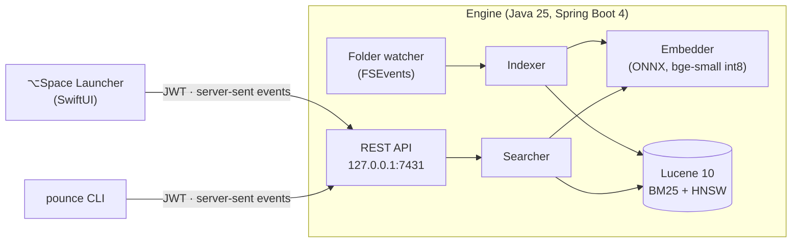

# Pounce

**Private, on-device semantic search for macOS.** Press a shortcut, start typing, and find your files by what they *say*, not only by their name. Everything runs on your Mac: no cloud, no API calls.


<sub>Real search results over a sample folder of fictional documents. [MP4 version](docs/media/pounce-demo.mp4).</sub>

Spotlight finds `certificate-renewal.md` when you type "certificate". Pounce also finds it when you type *"how do I renew the ssl cert"*, because it compares meaning, while still matching exact words like error codes and file names.

## Features

- **Search as you type** with a ⌥Space panel: keyword results appear instantly, then are refined by meaning a few milliseconds later.
- **Hybrid ranking**: BM25 keyword search and vector search from one Lucene index, merged with Reciprocal Rank Fusion.
- **On-device embeddings**: `bge-small-en-v1.5` (int8) through ONNX Runtime, sized for an 8 GB MacBook.
- **Live indexing**: native macOS file events (FSEvents); a saved, renamed or deleted file shows up in search in about half a second.
- **Text, Markdown, code and PDFs**, with the matching passage shown and the query's words highlighted.
- **Private by design**: the engine listens on `127.0.0.1` only and every request needs a short-lived, self-issued JWT.
- **`pounce` command** for the terminal, alongside the SwiftUI launcher.

## Install

Download `Pounce-<version>-macos-arm64.zip` from [Releases](../../releases), unzip it and move `Pounce.app` to `/Applications`.

Releases are not notarized yet, so the first time macOS will say it can't check Pounce for malware: right-click `Pounce.app` → **Open** → **Open**. macOS then asks for access to the folders Pounce watches.

Pounce watches `~/Documents`, `~/Desktop`, `~/Downloads` and `~/projects` by default. To change that, edit `~/Library/Application Support/Pounce/pounce.yml` and restart Pounce from its menu-bar icon:

```yaml
pounce:
  watched-folders: /Users/you/Documents,/Users/you/notes
```

Requires macOS 14 or later on Apple Silicon.

## How it works



The Engine is an onion of Maven modules: `pounce-domain` → `pounce-application` → `pounce-infrastructure` → `pounce-api`. Dependencies point inward only, which the compiler and ArchUnit tests enforce. The Launcher is the app you run; it starts and supervises the Engine as a child process, with a trimmed Java runtime and the model bundled inside `Pounce.app`.

Design decisions are recorded in [`docs/adr/`](docs/adr/), the module design in [`docs/design/`](docs/design/), and measurements in [`docs/research/`](docs/research/).

## Performance

Measured on an M2 MacBook Air with 8 GB of RAM ([details](docs/research/2026-11-23-speed-spike-verdict.md)):

| | p50 | p95 |
|---|---|---|
| Keyword results (50,000 documents) | 1.0 ms | 8.3 ms |
| Full hybrid results (50,000 documents) | 5.0 ms | 12.9 ms |
| Query embedding | 2.1 ms | 3.2 ms |

The running app uses roughly 230–450 MB, most of it while indexing. A new or changed file is searchable after about 0.5 s.

## Build from source

Needs JDK 25, Maven, and Xcode 16 or later.

```bash
scripts/fetch-model.sh          # downloads the embedding model into models/ (git-ignored)
mvn verify                      # Engine and CLI tests
(cd macos-app && swift test)    # Launcher tests
scripts/build-app.sh            # builds build/Pounce.app
scripts/smoke-app.sh            # checks the built app on a temporary folder
```

## Project layout

| Path | What |
|---|---|
| `pounce-domain`, `pounce-application`, `pounce-infrastructure`, `pounce-api` | The Engine |
| `pounce-cli` | The `pounce` terminal command |
| `macos-app` | The Launcher (Swift package) |
| `scripts` | Build, smoke-test and model scripts |
| `docs` | Decisions, design and research |

## Roadmap

- Application search and a settings window
- Skip unchanged files on restart; faster first indexing with batched embeddings
- Better ranking for Markdown with front matter, and a calibrated relevance cut-off
- Developer ID signing and notarization

## License

[MIT](LICENSE)
